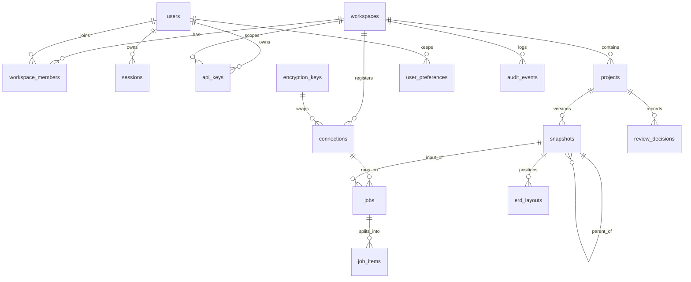

Status: draft | Owner: Backend lead | Last verified against code: pre-repo (2026-09-07)

# Metadata data model

The metadata store is PostgreSQL 16 managed by Alembic (`services/api/alembic/`, work package A01). It holds accounts, tenancy, snapshots, connections, jobs, review decisions, preferences, and the audit trail. It never holds customer row data: the only customer-derived content is the SchemaGraph JSON in `snapshots.graph`, which carries statistics only under the redaction policy in `security-architecture.md`.

None of these tables exist today. The baseline stores state in the browser (`backend-buddy:<project.key>:reviews` and `:theme` at `skill/assets/explorer.html:39-40`; `backend-buddy-erd:v1:<project.key>:<fingerprint>` at `packages/explorer/src/living-logic.ts:72`) and, for the skill's loopback server, in process memory (`packages/explorer/server/serve_explorer.py:74`, `nonlocal graph`). Column names below are the proposal for Alembic revision 0001 and are frozen by A01; anything marked "to be decided" is an A01 or A04 decision.

## 1. Conventions

- Primary keys are `uuid` (`gen_random_uuid()`), named `id`.
- Timestamps are `timestamptz`; every table has `created_at not null default now()`; mutable tables also have `updated_at`.
- **Tenant scoping (D4)**: every tenant-scoped table carries `workspace_id uuid not null references workspaces(id)` and an index leading with `workspace_id`. Every API query filters by the caller's workspace; a row in another workspace returns 404, never 403 (IDOR negative tests, CTQ-07). Row-level security is post-MVP (L-08); the column exists now so SaaS needs no rewrite.
- **Retention fields**: `deleted_at` for soft delete where the UI offers delete; `expires_at` for time-bounded rows; `retain_until` for purgeable rows. The purge job (A04, "simple retention purge of job_items") deletes only rows whose retention field has passed.
- Secrets are stored only as ciphertext (`bytea`) plus the key id; plaintext never reaches the database or a log.
- Names are `snake_case`; enumerations are `text` columns with a `check` constraint rather than PostgreSQL enums, so Alembic downgrades stay trivial.
- Every migration has a tested downgrade (upgrade -> downgrade -> upgrade in CI, CTQ-15).

## 2. Entity diagram



## 3. Tables

### 3.1 `workspaces`

The tenant. Single-tenant self-hosted deployments have one row created by `python -m app.bootstrap`.

| Column | Type | Notes |
|---|---|---|
| `id` | uuid PK | |
| `slug` | text unique not null | URL segment `:ws`; `[a-z0-9][a-z0-9-]*`, max 64 |
| `name` | text not null | display |
| `created_at`, `updated_at` | timestamptz | |
| `deleted_at` | timestamptz null | retention: soft delete |

Tenant scoping: is the tenant. Audit: create/rename/delete -> `audit_events`.

### 3.2 `users`

| Column | Type | Notes |
|---|---|---|
| `id` | uuid PK | |
| `email` | citext unique not null | login identifier |
| `password_hash` | text not null | argon2id (D5); min length 12 and top-10k deny list enforced in the API, not the DB |
| `display_name` | text null | |
| `is_active` | boolean not null default true | disable without delete |
| `password_changed_at` | timestamptz not null | session rotation reference |
| `failed_login_count` | int not null default 0 | lockout support (slowapi does rate limiting; this is for audit) |
| `created_at`, `updated_at` | timestamptz | |

Tenant scoping: none (a user may belong to several workspaces via `workspace_members`). Retention: none at MVP; erasure request handling is an open question (section 6).

### 3.3 `workspace_members`

| Column | Type | Notes |
|---|---|---|
| `workspace_id` | uuid FK workspaces | PK part |
| `user_id` | uuid FK users | PK part |
| `role` | text not null check in (`owner`,`admin`,`reviewer`,`viewer`) | RBAC (D5) |
| `created_at`, `updated_at` | timestamptz | |

PK `(workspace_id, user_id)`. Role change rotates the user's sessions (D5). Audit: role change.

### 3.4 `sessions`

Server-side sessions; the cookie carries only an opaque id.

| Column | Type | Notes |
|---|---|---|
| `id` | uuid PK | cookie value is a random 256-bit token; store `token_hash` (sha256) not the token |
| `token_hash` | bytea unique not null | |
| `user_id` | uuid FK users not null | |
| `csrf_token_hash` | bytea not null | double-submit CSRF (A02) |
| `created_at` | timestamptz | |
| `last_seen_at` | timestamptz not null | idle timeout |
| `expires_at` | timestamptz not null | retention: absolute lifetime; purge past rows |
| `revoked_at` | timestamptz null | revoke-all endpoint |
| `user_agent`, `ip` | text null | audit only, truncated |

Tenant scoping: none (user-level). Index `(user_id)`, `(expires_at)`.

### 3.5 `api_keys`

| Column | Type | Notes |
|---|---|---|
| `id` | uuid PK | |
| `workspace_id` | uuid FK workspaces not null | tenant scoping |
| `user_id` | uuid FK users not null | acting principal |
| `name` | text not null | label shown in UI |
| `key_prefix` | text not null | first 8 chars for identification |
| `key_hash` | bytea unique not null | sha256 of the secret; plaintext shown once at creation |
| `role` | text not null check as `workspace_members.role` | cannot exceed the creator's role |
| `created_at` | timestamptz | |
| `expires_at` | timestamptz null | retention |
| `revoked_at` | timestamptz null | |
| `last_used_at` | timestamptz null | |

Audit: create, revoke.

### 3.6 `projects`

| Column | Type | Notes |
|---|---|---|
| `id` | uuid PK | |
| `workspace_id` | uuid FK workspaces not null | tenant scoping |
| `key` | text not null | the SchemaGraph `project.key`; `[a-z0-9][a-z0-9_-]*` as enforced by `normalize()` (`skill/scripts/build_explorer.py:24`); unique per workspace |
| `name` | text not null | |
| `default_dialect` | text null | hint for uploads; snapshot `project.dialect` wins |
| `created_at`, `updated_at` | timestamptz | |
| `deleted_at` | timestamptz null | soft delete cascades logically to snapshots |

Unique `(workspace_id, key)`. Browser-side storage isolation continues to key on `project.key` (C13).

### 3.7 `snapshots`

Immutable SchemaGraph versions. Rows are never updated after insert except `deleted_at`.

| Column | Type | Notes |
|---|---|---|
| `id` | uuid PK | route segment `:snapshot` |
| `workspace_id` | uuid FK workspaces not null | tenant scoping (denormalised for query filtering) |
| `project_id` | uuid FK projects not null | |
| `graph` | jsonb not null | normalized SchemaGraph (output of `normalize()`), contract-valid |
| `sha256` | bytea not null | of the canonical JSON bytes as stored |
| `contract_version` | text not null | from `graph.contractVersion`, e.g. `1.0` |
| `origin` | text not null check in (`upload`,`extraction`,`profile`,`import`) | how the row came to exist |
| `parent_snapshot_id` | uuid FK snapshots null | set for `profile` results (merge base) and diffs |
| `source` | jsonb not null | copy of `graph.source` (file, commit, sha256, generated, basis) for listing without loading `graph` (C09) |
| `table_count`, `column_count`, `link_count` | int not null | listing columns; computed at insert, never from the private example |
| `size_bytes` | int not null | upload size cap check (value to be decided in A04) |
| `created_by` | uuid FK users null | null for API-key or job origin; `created_by_api_key` alternative to be decided in A04 |
| `created_at` | timestamptz | |
| `deleted_at` | timestamptz null | retention: soft delete; purge job removes `graph` after a grace period (value to be decided) |

Indexes: `(workspace_id, project_id, created_at desc)`, `(sha256)` for dedupe. Statistics inside `graph` obey `policy.py`; the retention scrubber for string extremes is post-MVP (L-04).

### 3.8 `connections`

| Column | Type | Notes |
|---|---|---|
| `id` | uuid PK | also the AAD for envelope encryption |
| `workspace_id` | uuid FK workspaces not null | tenant scoping |
| `project_id` | uuid FK projects null | optional default project for extractions |
| `name` | text not null | |
| `dialect` | text not null check in (`postgresql`,`sqlite`) | D6; others post-MVP |
| `mode` | text not null default `direct` check in (`direct`,`agent`) | reserved now for the SaaS customer-side connector (L-08); only `direct` at MVP |
| `host`, `port`, `database`, `username` | text / int | non-secret locator fields, shown in UI; for sqlite `database` is the file path inside the worker container |
| `tls_mode` | text not null default `verify-full` | maps to `sslmode` in `targets.py` (A03) |
| `encrypted_secret` | bytea not null | AES-256-GCM ciphertext of the password or DSN secret part; nonce prepended |
| `key_id` | uuid FK encryption_keys not null | wrapping key used |
| `allow_sample_values` | boolean not null default false | connection-level part of the triple opt-in |
| `allow_string_extremes` | boolean not null default false | string min/max opt-in |
| `last_tested_at` | timestamptz null | |
| `last_test_status` | text null | `ok` or a redacted reason |
| `created_by` | uuid FK users not null | admin or owner only |
| `created_at`, `updated_at` | timestamptz | |
| `deleted_at` | timestamptz null | soft delete; secret is zeroed (`encrypted_secret` set to empty) on delete |

The API never returns `encrypted_secret` or `key_id` (response schema test, CTQ-07). Secrets are write-only: an update replaces the ciphertext; there is no read path. Audit: create, update, test, delete.

### 3.9 `encryption_keys`

Wrapping-key registry for envelope encryption. The master key itself lives in a secret file (`/run/secrets/backend-buddy_master_key`), never in the database.

| Column | Type | Notes |
|---|---|---|
| `id` | uuid PK | referenced by `connections.key_id` |
| `algorithm` | text not null | `AES-256-GCM` |
| `master_key_fingerprint` | bytea not null | sha256 of the master key, to detect a swapped secret file at startup |
| `created_at` | timestamptz | |
| `retired_at` | timestamptz null | set by the rewrap CLI (L-04); rows stay so old ciphertext remains decryptable until rewrapped |

Tenant scoping: none (deployment-level). Delete is never allowed while a connection references the row.

### 3.10 `jobs`

| Column | Type | Notes |
|---|---|---|
| `id` | uuid PK | |
| `workspace_id` | uuid FK workspaces not null | tenant scoping |
| `kind` | text not null check in (`extract`,`profile`,`export`) | A04 |
| `status` | text not null check in (`queued`,`running`,`succeeded`,`partial`,`failed`,`cancelled`) | `partial` = some items incomplete |
| `connection_id` | uuid FK connections null | required for `extract`/`profile` |
| `snapshot_id` | uuid FK snapshots null | input snapshot (`profile`, `export`) |
| `result_snapshot_id` | uuid FK snapshots null | output (`extract`, `profile`) |
| `params` | jsonb not null | table selection, per-table budget, opt-ins; validated against a pydantic model |
| `per_table_seconds` | int not null | default 5, max 60 |
| `cap_seconds` | int not null | default 600, hard max 3600 |
| `requested_by` | uuid FK users not null | |
| `claimed_by` | text null | worker instance id |
| `claimed_at`, `started_at`, `finished_at` | timestamptz null | |
| `cancel_requested_at` | timestamptz null | worker checks between items |
| `error` | text null | redacted message only (no DSN, no values) |
| `created_at` | timestamptz | |
| `retain_until` | timestamptz null | retention: purge of finished jobs (value to be decided in A04) |

Indexes: `(status, created_at)` for the `FOR UPDATE SKIP LOCKED` claim; partial unique index `(connection_id) where status in ('queued','running')` enforces one running job per connection.

### 3.11 `job_items`

One row per table in a `profile` job (and per object class in `extract`).

| Column | Type | Notes |
|---|---|---|
| `id` | uuid PK | |
| `workspace_id` | uuid FK workspaces not null | tenant scoping |
| `job_id` | uuid FK jobs not null | |
| `table_id` | text not null | SchemaGraph `table.id` |
| `status` | text not null check in (`pending`,`running`,`done`,`partial`,`skipped`,`failed`) | |
| `reason` | text null | e.g. `per-table deadline`, `query budget`, `statement_timeout`; becomes `profiling.status='incomplete'` reason |
| `queries_used`, `elapsed_ms`, `rows_sampled` | int null | observability; never a fabricated row count |
| `started_at`, `finished_at` | timestamptz null | |
| `created_at` | timestamptz | |
| `retain_until` | timestamptz not null | retention: purged by the A04 purge job |

Index `(job_id, status)`.

### 3.12 `review_decisions`

Server-side replacement for `backend-buddy:<project.key>:reviews`.

| Column | Type | Notes |
|---|---|---|
| `id` | uuid PK | |
| `workspace_id` | uuid FK workspaces not null | tenant scoping |
| `project_id` | uuid FK projects not null | decisions follow the project across snapshots |
| `finding_id` | text not null | opaque, length-capped (value to be decided in A04); today the id is `[table, rule, columns, signature].join('|')` (`skill/assets/explorer.html:104`) so changed evidence reopens a finding; sha256 signatures are L-06 |
| `decision` | text not null check in (`open`,`investigate`,`intentional`,`resolved`) | |
| `note` | text null | length-capped |
| `decided_by` | uuid FK users not null | |
| `snapshot_id` | uuid FK snapshots null | snapshot in which the decision was made |
| `created_at`, `updated_at` | timestamptz | |

Unique `(project_id, finding_id)`. Audit: every change.

### 3.13 `erd_layouts`

Server-side counterpart of `backend-buddy-erd:v1:<project.key>:<fingerprint>` (`living-logic.ts:72`).

| Column | Type | Notes |
|---|---|---|
| `id` | uuid PK | |
| `workspace_id` | uuid FK workspaces not null | tenant scoping |
| `snapshot_id` | uuid FK snapshots not null | |
| `user_id` | uuid FK users null | null = shared layout |
| `view` | text not null | `living` at MVP; other views may persist later |
| `fingerprint` | text not null | graph fingerprint (`view-state.ts`, extracted from `snapshotKey`) |
| `positions` | jsonb not null | `{version:1, positions:{id:{x,y,pinned}}}` as `serializePositions` (`living-logic.ts:74`); validated with the same bounds as `parsePositions` (`:75-86`) |
| `created_at`, `updated_at` | timestamptz | |

Unique `(snapshot_id, view, coalesce(user_id, '00000000-0000-0000-0000-000000000000'))`.

### 3.14 `user_preferences`

| Column | Type | Notes |
|---|---|---|
| `user_id` | uuid FK users | PK part |
| `workspace_id` | uuid FK workspaces | PK part; tenant scoping |
| `theme` | text not null default `system` check in (`dark`,`light`,`system`) | mirrors the host select (`explorer.html:21`) |
| `reduced_motion` | boolean null | null = follow OS |
| `prefs` | jsonb not null default `{}` | allowlisted keys only, validated in the API |
| `updated_at` | timestamptz | |

### 3.15 `audit_events`

Insert-only. The trigger below rejects UPDATE and DELETE (CTQ-16).

| Column | Type | Notes |
|---|---|---|
| `id` | bigint generated always as identity PK | monotonic for export |
| `workspace_id` | uuid null | null for deployment-level events (bootstrap, key rotation) |
| `actor_user_id` | uuid null | |
| `actor_api_key_id` | uuid null | |
| `action` | text not null | `login.success`, `login.failure`, `logout`, `session.revoke_all`, `api_key.create`, `api_key.revoke`, `member.role_change`, `connection.create`, `connection.update`, `connection.test`, `connection.delete`, `job.submit`, `job.cancel`, `job.finish`, `snapshot.upload`, `snapshot.delete`, `export.download`, `review.decide`, `workspace.*` |
| `target_type`, `target_id` | text null | |
| `request_id` | text null | correlates with structlog JSON |
| `ip` | inet null | |
| `details` | jsonb not null default `{}` | redacted; never a secret, DSN, or sampled value |
| `occurred_at` | timestamptz not null default now() | |

Retention: none at MVP (append-only); export and archival is an operations question (section 6).

```sql
create or replace function audit_events_immutable() returns trigger
language plpgsql as $$
begin
  raise exception 'audit_events is insert-only (% rejected)', tg_op
    using errcode = '42501';
end $$;

create trigger audit_events_no_update_delete
  before update or delete on audit_events
  for each row execute function audit_events_immutable();
```

`ops/sql/roles.sql` (A01) additionally grants the API role `insert, select` only on `audit_events`, so the trigger is defence in depth rather than the only control.

## 4. Tenant-scoping summary

| Table | `workspace_id` | Why |
|---|---|---|
| workspaces | is the tenant | |
| users, sessions, encryption_keys | no | user-level or deployment-level |
| workspace_members, api_keys, projects, snapshots, connections, jobs, job_items, review_decisions, erd_layouts, user_preferences | yes, not null | tenant data |
| audit_events | nullable | deployment-level events exist |

Tenant-scoping tests (A01): for every table with `workspace_id`, a query helper that omits the workspace filter fails a static check, and an API test proves cross-workspace ids return 404.

## 5. Retention summary

| Table | Field | Behaviour |
|---|---|---|
| sessions | `expires_at`, `revoked_at` | purge expired rows; revoke-all sets `revoked_at` |
| api_keys | `expires_at`, `revoked_at` | never purged (audit reference); unusable once set |
| jobs | `retain_until` | purge finished jobs after retention (value to be decided) |
| job_items | `retain_until` | purged by the A04 purge job |
| snapshots, projects, connections, workspaces | `deleted_at` | soft delete; `graph` purge grace period to be decided; connection secret zeroed immediately |
| audit_events | none | append-only |

## 6. Open questions for A01/A04

1. Snapshot upload size cap and `finding_id` length cap (the plan says "size cap" and "length-capped" without values).
   - `finding_id` length cap: **decided in A01: 512 characters**, as `check (char_length(finding_id) between 1 and 512)`. The value is not arbitrary: `finding_id` is the second column of the unique index `uq_review_decisions_project_id_finding_id`, and a PostgreSQL btree key must fit in about 2,704 bytes, which 512 characters cannot exceed even at four bytes per character. `TEXT_CAP` (4,096) can, so it is not usable here. `note` takes `TEXT_CAP` because it is not indexed. Both live in `services/api/app/models/base.py` as `FINDING_ID_CAP` and `TEXT_CAP`, so widening either is a one-line migration. Pending confirmation by the Backend lead at G2; a wider cap is a forward-only migration with no data loss.
   - Snapshot upload size cap: **still open, owner Backend lead, needed by G2** (A04, `BB_SNAPSHOT_MAX_BYTES`). A01 deliberately imposes no cap in the database: `snapshots.size_bytes int not null check (size_bytes >= 0)` records the stored size so the API can enforce whatever value is chosen without a migration.
2. Grace period before a soft-deleted snapshot's `graph` is purged, and whether purge is hard delete or `graph = null`. **Still open, owner Backend lead, needed by G2** (A04 owns the purge job). A01 provides `snapshots.deleted_at` and nothing else; `graph` is `not null`, so a decision to blank it rather than delete the row would need a migration, which is the argument for deciding before A04 starts.
3. Whether `connection.test` runs in the worker (a fourth job kind) or synchronously in the API process; this decides whether the API process ever holds a decrypted secret (see `security-architecture.md` section 4). **Still open, owner Security lead, needed by G2** (it gates A02 and A03). A01 leaves both routes available at no cost: `connections.last_tested_at` and `last_test_status` exist either way, and the `jobs.kind` check constraint would need a one-line migration only if a fourth kind `test` is chosen.
4. User erasure: the model supports deactivation; a GDPR-style erasure flow would need `audit_events.actor_user_id` handling and is not in the MVP definition. **Still open, owner Product owner, needed by REL** (it is part of the compliance-regime question in `security-architecture.md` section 10). A01 makes the eventual flow possible without a schema change: `audit_events` carries no foreign keys at all, so `actor_user_id` can be set to null for an erased user without breaking referential integrity or losing the trail.
5. Whether `erd_layouts` should also carry Schema City camera and mode (today localStorage, C13) or leave those client-side at MVP. **Still open, owner Frontend lead, needed by G2** (C13 and W05). A01 keeps the table open to either answer: `erd_layouts.view` is validated for length only, not against a list of view ids, so a second view persists a layout without a migration.
