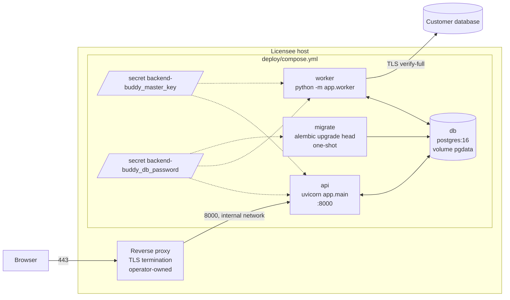

Status: draft | Owner: Platform lead | Last verified against code: pre-repo (2026-09-07)

# Deployment architecture

Single-tenant, self-hosted Docker Compose at MVP (D4): one image built from this repository runs as three services (`migrate`, `api`, `worker`) beside a PostgreSQL 16 `db`. TLS is terminated by the operator's reverse proxy. A `dev` overlay adds Vite HMR and a fixture PostgreSQL; a `qa` overlay adds Playwright. The offline artifact and the skill need none of this. Work package O01 builds it; O02 wires CI; O03 adds observability; the operator runbooks live in `docs/operations/` (D06, O01).

Nothing in this document exists as code yet: the repository has no Dockerfile, compose file, `.dockerignore`, or `.env.example` (verified). What does exist and constrains the design: the build orchestrator `scripts/project.mjs` (Python located through `process.env.PYTHON`, `:10`; default schema `fixtures/schemas/medium.json` with `--schema` and `BB_SCHEMA` overrides, `:89`), `engines` `node >= 22`, `npm >= 10.5.1` in both `package.json` files, `.nvmrc`, the loopback server that binds `127.0.0.1` (`packages/explorer/server/serve_explorer.py:113`), and CI workflows in `.github/workflows/ci.yml` and `security.yml`.

## 1. Topology

| Service | Image | Command | Depends on | Exposed |
|---|---|---|---|---|
| `db` | `postgres:16` pinned by digest | default | none | internal only; volume `pgdata` |
| `migrate` | app image | `alembic upgrade head` | `db` healthy | none; exits 0 |
| `api` | app image | `uvicorn app.main:app --host 0.0.0.0 --port 8000` | `migrate` completed successfully | `127.0.0.1:8000` on the host by default (proxy in front) |
| `worker` | app image | `python -m app.worker` | `migrate` completed successfully | none |

Ordering uses `depends_on` with `condition: service_healthy` for `db` and `condition: service_completed_successfully` for `migrate`, so `api` never starts against an unmigrated schema.

## 2. Image

Multi-stage `deploy/Dockerfile` (O01):

1. `node:22-bookworm-slim` (pinned digest): `npm ci` in `packages/explorer` and `packages/web`, `npm run build` (explorer IIFE for the export path, Vite SPA bundle, `syncSkill`).
2. `python:3.13-slim-bookworm` (pinned digest): install `services/api` and `packages/profiler` with pinned requirements (`psycopg[binary]`, `fastapi`, `uvicorn`, `sqlalchemy`, `alembic`, `argon2-cffi`, `cryptography`, `jsonschema`, `structlog`, `slowapi`, `pydantic-settings`); copy the SPA `dist` and `skill/` (renderer template and icons) from stage 1.
3. Runtime: non-root user `10001`, read-only root filesystem with `tmpfs` for `/tmp`, `HEALTHCHECK` on `/healthz`, no shell in the final image if practical, labels with git sha and version.

`.dockerignore` mirrors `.gitignore` and additionally excludes `.git`, `docs/`, `tests/`, and `.github/`. The image contents are listed in CI to prove `reference/`, `examples/`, `.qa/`, `dist/backend-buddy.html`, and any PNG are absent (CTQ-14).

## 3. Overlays

### 3.1 `deploy/compose.dev.yml`

- `web-dev`: `node:22` running `vite` with HMR on `5173`, proxying `/api` to `api`.
- `api` runs `uvicorn --reload` with source bind-mounted.
- `fixture-db`: a second PostgreSQL seeded from `fixtures/sql/pg/seed.sql` (R01), registered as a sample connection for local extraction and profiling.
- `BB_ALLOW_PRIVATE_TARGETS=true` so the worker may connect to `fixture-db` (a private address); the default in `compose.yml` is `false`.
- Cookie falls back to a non-`__Host-` name over plain HTTP with a startup warning (A02).

### 3.2 `deploy/compose.qa.yml`

- `playwright`: `mcr.microsoft.com/playwright` pinned to the `@playwright/test` version in `package.json`, bundled Chromium with `--use-angle=swiftshader --enable-unsafe-swiftshader` (already the proven flag pair, `scripts/verify_host.mjs:40`), running `tests/{e2e,a11y,perf,security}` against `api`.
- Real PostgreSQL profiler tests (Q03) run here against `fixture-db`.

## 4. Environment contract

Configuration is read by `pydantic-settings` (A02) from environment variables and `*_FILE` secret paths. Names below are the proposal to be frozen in O01/A02 and documented in `deploy/.env.example`; secrets are never passed as plain environment variables in `compose.yml`, only as Docker secrets.

| Variable | Default | Required | Purpose |
|---|---|---|---|
| `BB_DB_HOST`, `BB_DB_PORT`, `BB_DB_NAME`, `BB_DB_USER` | `db`, `5432`, `backend-buddy`, `backend-buddy` | yes | metadata store locator |
| `BB_DB_PASSWORD_FILE` | `/run/secrets/backend-buddy_db_password` | yes | metadata store password (secret) |
| `BB_MASTER_KEY_FILE` | `/run/secrets/backend-buddy_master_key` | yes | 32-byte envelope master key (secret); startup fails if missing or wrong length |
| `BB_PUBLIC_ORIGIN` | none | yes in production | `https://host` used for cookie `Secure`, CSRF origin checks, and absolute links |
| `BB_COOKIE_SECURE` | `true` | no | dev overlay sets `false` with a warning |
| `BB_SESSION_IDLE_MINUTES`, `BB_SESSION_ABSOLUTE_HOURS` | to be decided in A02 | no | session lifetimes |
| `BB_ALLOW_PRIVATE_TARGETS` | `false` | no | permit connections to loopback, link-local, and metadata hosts (`targets.py`) |
| `BB_DEFAULT_TLS_MODE` | `verify-full` | no | default `connections.tls_mode` |
| `BB_JOB_TABLE_SECONDS_DEFAULT` / `_MAX` | `5` / `60` | no | per-table budget (`docs/reference/limits-and-caps.md` B) |
| `BB_JOB_CAP_SECONDS_DEFAULT` / `_MAX` | `600` / `3600` | no | job-level cap |
| `BB_SNAPSHOT_MAX_BYTES` | to be decided in A04 | no | upload cap |
| `BB_LOG_LEVEL` | `info` | no | structlog JSON |
| `BB_RATE_LIMIT_LOGIN` | to be decided in A02 | no | slowapi rule |
| `BB_WORKER_CONCURRENCY` | `1` | no | items processed in parallel per worker |
| `BB_SCHEMA` | `fixtures/schemas/medium.json` | no | build-time default schema for the artifact (`scripts/project.mjs:89`) |
| `PYTHON` | `python` on Windows, `python3` elsewhere | no | interpreter used by `scripts/project.mjs:10`; CI sets `python3` (`ci.yml`) |
| `BB_DENYLIST_FILE` | none | local only | private-name denylist for `scripts/private_data_guard.mjs`; never in the repo or an image |

Rules: unknown `BB_*` variables fail startup (typo protection); every variable appears in `.env.example` with a comment; secrets have no default other than the secret-file path.

## 5. TLS and network

- TLS is terminated by the operator's reverse proxy (Caddy, nginx, Traefik); a Caddy profile is L-07. The API listens on plain HTTP inside the compose network and on `127.0.0.1:8000` on the host by default so it is never exposed unproxied by accident.
- The proxy forwards `X-Forwarded-Proto` and `X-Forwarded-For`; the API trusts them only from the compose network.
- HSTS is emitted when `BB_PUBLIC_ORIGIN` is `https`.
- Customer database connections use `tls_mode=verify-full` by default; CA bundles are mounted read-only into the worker when a private CA is needed (operator step in `docs/operations/deployment.md`).
- Outbound from the worker is restricted by `targets.py` (deny private ranges unless allowed); network-level egress rules are an operator recommendation.

## 6. Health, readiness, observability

- `GET /healthz`: process alive; `GET /readyz`: database reachable, migrations at head, master key fingerprint matches `encryption_keys`.
- CTQ-15: `docker compose up` on a clean machine reaches `/readyz` in under 5 minutes.
- Logs: structlog JSON to stdout with request id and redaction; metrics (`http_requests_total`, `jobs_total{kind,status}`, `job_items_incomplete_total{reason}`, `profiler_redactions_total{class}`) exposed for scraping in O03; OpenTelemetry is L-04.

## 7. Backup and restore (outline; runbook in O01)

- Back up: `pg_dump` of the metadata database from the `db` container to an operator-controlled location; back up the master key file separately, encrypted, off host. Without the master key, connection secrets in a restored database are unusable and must be re-entered (plan risk "Master-key loss").
- Restore: restore `pgdata` or `pg_restore` into a fresh `db`, place the same master key file, run `migrate`, verify `/readyz` (fingerprint check catches a wrong key).
- Backups contain snapshots (schema metadata and statistics under the redaction policy) and the audit trail; they are classified as confidential.
- `ops/backup.sh` and `ops/restore.sh` land in O03 and are exercised once in CI's compose-smoke job.

## 8. Upgrade and rollback (outline; runbooks `upgrade.md`, `rollback.md` in O01)

- Upgrade: pull the new image tag, run `migrate` (Alembic `upgrade head`), restart `api` and `worker`. Every migration ships a tested downgrade.
- Rollback: `alembic downgrade <previous revision>` from the new image, then start the previous image tag. CI rehearses `up -> /readyz -> upgrade -> downgrade -> upgrade -> previous tag` (CTQ-15).
- Images are tagged by version and git sha; `release.yml` (O02) publishes to `ghcr.io/cesprototypers/backend-buddy` on tag and checks the CHANGELOG section.
- Data compatibility: snapshots carry `contract_version`; an image that cannot read a stored major version refuses to start rather than misrender (ADR-0003).

## 9. The skill and the artifact (no deployment)

The offline artifact (`dist/backend-buddy.html`) is opened from `file://` and makes no network requests (CTQ-05). The skill's loopback server remains a developer tool: after S03 it accepts `--bind` and `--allowed-hosts` (default `127.0.0.1:<port>`, `localhost:<port>`) so it can run inside a container with a 1:1 port mapping, but it is not part of the compose deployment and carries no user authentication.

## 10. Open questions

1. Whether to ship a Caddy-based TLS profile at MVP for licensees without an existing proxy (currently L-07).
2. Whether `worker` runs as a separate scaled service in SaaS (L-08) or stays single-instance; the `SKIP LOCKED` queue already permits several.
3. Retention values for jobs, job items, and soft-deleted snapshots (see `data-model.md` section 6).
4. Whether the dev overlay's `fixture-db` should also seed a SQLite file into a shared volume so both dialects are exercisable from the UI.
