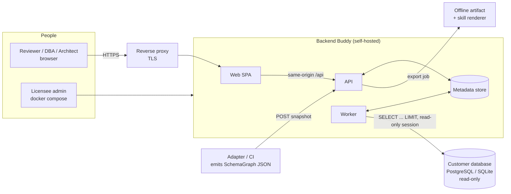
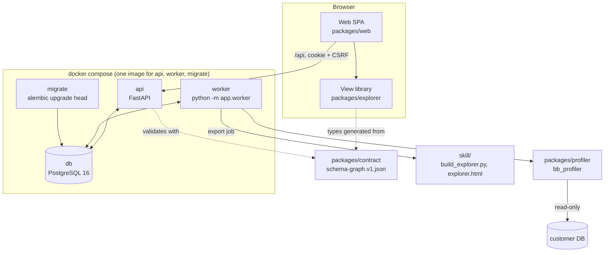

Status: draft | Owner: Platform lead | Last verified against code: pre-repo (2026-09-07)

# Architecture overview

This document describes the system at the C4 context and container levels, maps every target component to the code that exists today, and traces the main data flows. Decisions are recorded in `docs/architecture/adr/`; contracts live in `schema-graph-contract.md` and `drill-through-contract.md`; the security and deployment views are in their own documents. Line citations are against `packages/explorer/src`, `packages/explorer/server`, `skill/assets/explorer.html`, and `skill/scripts/build_explorer.py`; `skill/assets/extensions/` is a generated copy and is never cited.

## 1. What exists today (baseline)

The product currently ships as one self-contained HTML file. `skill/assets/explorer.html` is a vanilla-JS host: theme select and 13-tab tablist (`explorer.html:21-22`), global filters (`:23`), content pane plus inspector (`:24`), status footer (`:25`), and four natively rendered views (`map`, `entities`, `keys`, `review`). Nine React views live in `packages/explorer/src` and are compiled by esbuild into one IIFE exposing `window.BackendBuddyViews.mount/unmount` (`packages/explorer/build.mjs:2`, `packages/explorer/src/index.tsx:21-22`). `skill/scripts/build_explorer.py` validates the schema JSON in `normalize()` (`build_explorer.py:21-96`) and inlines bundle, CSS, icons, and data into the template in one regex pass (`build_explorer.py:99-108`). `scripts/project.mjs` orchestrates build (`:97-103`) and test (`:104-115`) and mirrors `packages/explorer` into `skill/assets/extensions` (`syncSkill`, `:52-60`).

A bounded read-only profiler exists in Python: `packages/explorer/server/schema_profiler.py` (SQLite and PostgreSQL, constants at `:73-80`) behind a loopback-only HTTP wrapper `serve_explorer.py` (three routes, bind `127.0.0.1` at `:113`).

There is no SPA, router, store, API, database, worker, container, or CI e2e. The full gap list is in the approved plan and in `docs/features/README.md` (status column).

## 2. System context (C4 level 1)

**Users.** Architects, DBAs, backend developers, data analysts, engineering managers, and a licensee's security reviewer (personas P1-P6 in `docs/business/business-case.md`). They use a browser.

**External systems.**

- Customer databases: PostgreSQL and SQLite at MVP (D6), opened read-only by the worker only, never by the browser and never implicitly (C14).
- An operator reverse proxy that terminates TLS in front of the API (D4).
- An adapter or CI job that produces SchemaGraph JSON from ORM sources or a live catalog and uploads it as a snapshot (`skill/references/extraction.md`).
- The portable skill consumer: an agent or person running `skill/scripts/build_explorer.py` and, optionally, `serve_explorer.py`, without the platform (F22).

Trust boundaries and threat summary are in `security-architecture.md`.

## 3. Containers (C4 level 2)

| Container | Technology | Responsibility | Talks to |
|---|---|---|---|
| Web SPA (`packages/web`) | Vite, React 19, TypeScript, React Router 7 (library mode), Zustand | Login, workspace/project/snapshot pages, upload, connections page with job progress, `ViewHost` mounting exactly one view without remount on filter change, tablist, filters synced to URL, theme, API client with CSRF | API (same origin, cookie session) |
| View library (`packages/explorer`) | React 19, TypeScript, node:test only; no router, fetch, or Vitest imports allowed | 13 views (9 existing, 4 ported from the host), Inspector, tokens and theme, route-state, selection, navigation registry, view-state, caveat strings, pure logic modules, IIFE mount for the artifact | Consumed by the SPA and by the artifact build |
| Contract (`packages/contract`) | JSON Schema draft 2020-12, codegen script | `schema-graph.v1.json`, generated `contract.generated.ts`, valid/invalid corpus | Explorer (types), profiler (validation), API (validation) |
| API (`services/api`) | Python 3.13, FastAPI, SQLAlchemy, Alembic, pydantic-settings, structlog | REST, authn/authz, CRUD for workspaces/projects/snapshots/connections/reviews/preferences, snapshot validation (jsonschema + `normalize()`), job submission, audit, health | Metadata store; serves the SPA bundle with a strict CSP |
| Worker (same image, `python -m app.worker`) | Python 3.13 | Claims jobs with `FOR UPDATE SKIP LOCKED`; runs `extract`, `profile`, `export`; per-table budgets and partial results; cancel | Metadata store; customer databases; `build_explorer.render()` |
| Profiler (`packages/profiler/bb_profiler`) | Python, psycopg 3 optional | `Driver` protocol, `BoundedReader`, `_Graph` allowlist, stats/FD/sample primitives, `policy.py` redaction, `targets.py` deny list and TLS mode, `compat.py` | Imported by the worker; mirrored into the skill |
| Metadata store | PostgreSQL 16 | Tables in `data-model.md`; insert-only `audit_events` | API, worker, migrate |
| Migrate (one-shot) | Alembic in the API image | `alembic upgrade head` before API and worker start | Metadata store |
| Skill (`skill/`) | Python stdlib renderer, esbuild IIFE, hardened loopback server | Offline artifact, `serve_explorer.py` with `--bind`/`--allowed-hosts`, cookie token | Runs without the platform |

## 4. Component map: target component to existing code

| Target component | Existing code mapped in | Notes |
|---|---|---|
| SPA shell: theme, tablist, filters | `skill/assets/explorer.html:21-23` (markup), `:66-69` (tab keyboard model and filter listeners), `:60` (`scoped()` filter semantics), breakpoints `:12-14` | Re-expressed in React; keyboard model (`ArrowLeft/Right/Home/End`, `:67`) preserved |
| `ViewHost` (one view, no remount) | Replaces `render()` at `explorer.html:178`, which calls `unmount()` unconditionally, and `mount()` at `index.tsx:22`, which always creates a new root | Root reuse lands in C03 (`mount-policy.ts`); see ADR-0002 |
| Inspector (`Inspector.tsx`) | `detail()` at `explorer.html:73-80`, `selectTables()` at `:64`, actions `#focusEntity`/`#entityKeys` at `:78`, `findingDetail()` at `:127` | W02 |
| Ported host views: map, entities, keys, review | `bindMapPan` (`explorer.html:135-154`) and `renderMap` (`:155-176`, `el()` factory `:162`), `renderEntities`, `renderKeys`, `renderReview`; findings engine `buildFindings()` `:102-126`; SQL helpers `quote`/`tableSQL`/`readonly`/`duplicates`/`orphanSQL` `:97-101`; `exportCSV` `:180`; `exportSVG` `:182` | W03; parity test against inline `buildFindings` before deletion |
| Nine React views | `Fanout.tsx`, `ColumnTable.tsx`, `City.tsx` (+ `CityDistricts` at `index.tsx:16-20`), `LivingERD.tsx`, `NormalizationLens.tsx`, `Domains.tsx`, `JoinMatrix.tsx`, `ArcDiagram.tsx`, `SchemaDiff.tsx` | Compile untouched against additive `ViewProps` (ADR-0004) |
| Pure logic modules | `city-layout.ts`, `column-logic.ts`, `dependency-logic.ts`, `fanout-logic.ts`, `lens-domain-logic.ts`, `living-logic.ts`, `schema-diff-logic.ts` (75 node:test cases) | Reused as-is; `insights-logic.ts` (W06) composes them |
| Design tokens and theme | 16 CSS variables at `explorer.html:9-10`; per-component theme reads such as `JoinMatrix.tsx:103-111` (MutationObserver on every ancestor) | C02: `tokens.css`, `palettes.ts`, `theme.tsx`; single observer |
| Route state and selection | None. `state` object at `explorer.html:37`; selection only flows up through `onSelectTable`/`onSelectTables` (`types.ts:10`) | C03: `route-state.ts`, `selection.ts`, `navigation.ts`, `view-state.ts` |
| Graph fingerprint | `snapshotKey()` at `living-logic.ts:68-73` | Extracted to `view-state.ts` with unchanged output |
| Contract types | `packages/explorer/src/types.ts:1-10` | Generated `contract.generated.ts` re-exported by `types.ts` (ADR-0003) |
| Contract oracle | `normalize()` at `build_explorer.py:21-96` (13 rules) | Python validates with `jsonschema`, then runs `normalize()` |
| Profiler core | `schema_profiler.py`: constants `:73-80`, `_quote` `:87-90`, `_Graph` `:119+`, `connect_readonly` `:189-224`, `_Reader` `:227-270` (`select` `:246-270`), `_reader` `:273-291` | Moved to `packages/profiler/bb_profiler` with `compat.py` so `connect_readonly`/`profile`/`subtree` and 51 tests pass unchanged |
| Live catalog introspection | None (`source.basis` defaults at `build_explorer.py:30`) | New in A03: `introspect()` for PostgreSQL and SQLite |
| Loopback server (skill) | `serve_explorer.py`: token `:40`, address `:42`, Host check `:58-59`, GET `:61-71`, POST `:73-111`, bind `:113` | S03 hardening; retained for F22 |
| Artifact renderer | `build_explorer.py` `render()` `:99-108` | S01 hardening; called by the `export` job |
| Fixtures and QA harness | `scripts/verify_host.mjs` (13-view Playwright harness); `skill/scripts/check_explorer.cjs` | S02 parameterises the harness; R01 generates fixtures |
| Metadata store, API, worker, auth, jobs, audit | New | A01-A04 |
| Compose, CI, observability | `.github/workflows/{ci,security}.yml` exist (R00); no Docker yet | O01-O03 |

## 5. Data flows

### 5.1 Snapshot ingest

1. Client uploads SchemaGraph JSON (`POST /api/w/{ws}/p/{project}/snapshots`), size-capped.
2. API validates against `packages/contract/schema-graph.v1.json` (`jsonschema`), then runs `build_explorer.normalize()` as the semantic oracle (unique ids, declared-FK resolution, composite groups, inferred-link dedupe: `build_explorer.py:32-95`).
3. Stored in `snapshots` with `graph` (jsonb), `sha256`, `contract_version`, `origin='upload'`, `source` provenance; immutable thereafter.
4. SPA fetches the graph with ETag and gzip; the view library never fetches (ESLint `no-restricted-imports`).

### 5.2 Extraction (live catalog)

1. An admin registers a connection: secret encrypted in the API with envelope encryption (`security-architecture.md`, section 4), stored write-only.
2. A reviewer submits an `extract` job; the worker decrypts the secret, opens a read-only session (`connect_readonly` semantics: `schema_profiler.py:196-199`, `:215-219`), runs `introspect()`, and writes a new snapshot with `origin='extraction'` and `source.basis='Live catalog extraction'`.
3. The connection's `last_tested_at`/status and an audit row are updated.

### 5.3 Profiling

1. A `profile` job is created with one `job_item` per selected table and a `Budget(perTableSeconds default 5, max 60)`, plus a job cap (default 600 s, hard max 3600 s).
2. The worker runs `profile_table` per item; on budget exhaustion the item is `partial` with a reason and `profiling.status='incomplete'`; other items continue. Unknown stays unknown, never zero (C01). This replaces the whole-run `ProfileLimitError` at `schema_profiler.py:238-240` (docstring `:58-59`: "no partial success is returned").
3. Results merge into a new snapshot with `parent_snapshot_id` set; `policy.py` decides which statistics may be stored (secret columns: `nullFraction` only; string min/max off by default; samples triple opt-in, max 3).
4. The SPA polls `GET /api/jobs/{id}`; one running job per connection is enforced by a partial unique index.

### 5.4 Reviews

1. The SPA computes findings with `review-logic.ts` (ported from `buildFindings()`, `explorer.html:102-126`; finding id signature at `:104`).
2. `PUT /api/.../reviews/{findingId}` records `open | investigate | intentional | resolved` server-side; the id is opaque, length-capped, and validated against the loaded graph.
3. Browser storage remains convenience state only (C13); today decisions live under `backend-buddy:<project.key>:reviews` (`explorer.html:39-40`).

### 5.5 Export

1. An `export` job calls `build_explorer.render()` with the snapshot graph; the artifact CSP is the byte-identical string in `explorer.html:6` (D9, CTQ-05).
2. `sampleValues` and string min/max are stripped unless the exporter opts in.
3. Download uses `Content-Disposition: attachment`. CSV/SVG/PNG exports remain client-side (`exportCSV` `explorer.html:180`, `exportSVG` `:182`, Living ERD PNG).

### 5.6 Drill-through and URL state

Selection and navigation are described in `drill-through-contract.md`: the route `/w/:ws/p/:project/s/:snapshot/:view` carries `t c r ts f q d k v.*`; the same grammar is shared with the artifact through `location.hash`. Per-view state (camera, pan, loaded diff snapshots) is persisted in a slice keyed by the graph fingerprint.

## 6. Cross-cutting concerns

- **Contract**: one JSON Schema, generated TypeScript, Python `jsonschema` + `normalize()` (ADR-0003, `schema-graph-contract.md`).
- **Caveats**: `docs/reference/caveats.md` is canonical; UI strings only from `packages/explorer/src/caveat-strings.ts` (D8).
- **Theming**: 16 host variables become `tokens.css` byte-identically; six data palettes gain light/dark values; `domainColor()` replaces the 7-colour cycle at `city-layout.ts:77` and `:194` (C02, F21).
- **Security**: trust boundaries, credential lifecycle, and the eight baseline findings are in `security-architecture.md`.
- **Observability**: structlog JSON with request id and redaction; audit rows for login, key/connection changes, jobs, exports, decisions; `/healthz` and `/readyz` (CTQ-16, O03).
- **Performance budgets**: `docs/reference/limits-and-caps.md` section B (CTQ-09).
- **Private data**: never enters the repository; guard in `scripts/private_data_guard.mjs` (CTQ-14, ADR-0007).

## 7. Related documents

- `docs/architecture/data-model.md`, `schema-graph-contract.md`, `drill-through-contract.md`, `security-architecture.md`, `deployment-architecture.md`
- `docs/architecture/adr/ADR-0001` to `ADR-0008`
- `docs/architecture/legacy-handoff.md` (baseline provenance)
- `docs/features/README.md`, `docs/reference/caveats.md`, `docs/reference/limits-and-caps.md`
