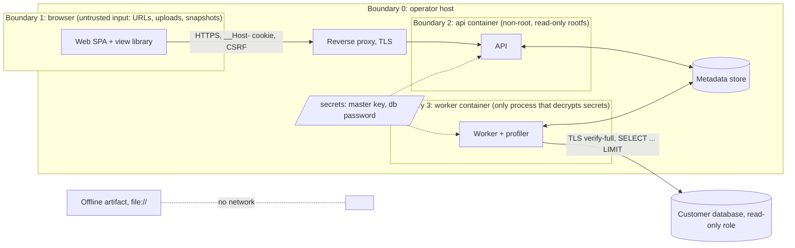

Status: draft | Owner: Security lead | Last verified against code: pre-repo (2026-09-07)

# Security architecture

This document describes trust boundaries, principals, the credential lifecycle, the per-component threat summary, the eight concrete findings in the baseline with their owning work packages, and the two Content Security Policies. The engineering rules derived from it are in `docs/engineering/security-policy.md` (D03); the STRIDE model with control-to-test mapping lands in `docs/security/threat-model.md` (Q02). Caveat text is quoted from `docs/reference/caveats.md`.

## 1. Baseline posture

The baseline is a single-user local tool. Its security model is: an offline HTML artifact under a strict CSP (`skill/assets/explorer.html:6`), and an optional loopback server (`packages/explorer/server/serve_explorer.py`) that binds `127.0.0.1` (`:113`), requires an exact `Host` (`:58-59`) and `Origin` (`:75`) match, compares a per-process token with `hmac.compare_digest` (`:79`), caps bodies at 64 KiB (`:83-84`), serialises jobs with a lock (`:89-90`), and collapses all database errors to fixed strings (`:107-111`). The profiler never executes graph-supplied SQL: identifiers are quoted and allowlisted (`schema_profiler.py:87-90`, `_Graph` `:119+`), values are bound, SQLite runs under `PRAGMA query_only` (`:199`, `:277-284`), PostgreSQL under `default_transaction_read_only` and `statement_timeout` (`:215-216`, `:288-290`). Nothing connects on import and credentials are read only from an operator-named environment variable (`serve_explorer.py:35`).

That model has no user identity, no authorization, no TLS policy, no rate limiting, no audit trail, and hands its capability token to any unauthenticated loopback caller (`serve_explorer.py:61-71`). The platform keeps the profiler's guarantees and adds the missing layers.

## 2. Trust boundaries and principals



| Principal | Authenticates with | May |
|---|---|---|
| viewer | session cookie or API key | read snapshots, views, findings, decisions in its workspace |
| reviewer | same | viewer + record decisions, submit `profile`/`extract`/`export` jobs on registered connections |
| admin | same | reviewer + create/update/test/delete connections, manage members below owner, API keys |
| owner | same | admin + workspace settings, role changes, revoke-all |
| worker | database credentials from a secret file; no HTTP identity | claim jobs, decrypt connection secrets, open read-only sessions, write snapshots and job items |
| operator | host access, `docker compose` | everything above by construction; controls are procedural (runbooks, backups) |

Roles are declared per route; `test_rbac_matrix` (A02) fails on any undeclared route. Cross-workspace ids return 404 (IDOR negatives, CTQ-07).

## 3. Threat summary per component

| Component | Assets | Main threats | Controls (WP) |
|---|---|---|---|
| Web SPA and view library | session, CSRF token, rendered schema text, browser storage | XSS from hostile snapshot text; CSRF; deep-link fuzz; storage cross-project bleed; prototype pollution via `colors[t.type]` (`explorer.html:41`, `:171`) | React escaping by default; strict SPA CSP (section 6); `route-state` allowlists and caps; keys scoped by `project.key` and fingerprint (C13); `Object.hasOwn` (S01); hostile fixture rendered through all 13 views (Q02) |
| API | sessions, API keys, snapshots, connection ciphertext, audit | credential stuffing; session fixation; IDOR; oversized uploads; SQL/JSON abuse; secret disclosure in responses or logs | argon2id, min length 12, deny list; server-side sessions with `__Host-` cookie, rotation on login and role change, revoke-all; CSRF double submit; RBAC matrix; size caps; `jsonschema` + `normalize()`; response schemas without secret fields; structlog redaction; slowapi rate limits; security headers (A02, A04) |
| Worker and profiler | decrypted secrets in memory, customer database, statistics | SSRF to internal hosts; writes to customer DB; unbounded scans; data exfiltration via statistics; secret leakage in errors | `targets.py` deny list (loopback, link-local, metadata hosts unless `BB_ALLOW_PRIVATE_TARGETS`); `tls_mode` default `verify-full`; read-only session setup per driver; `Budget`/`BoundedReader`; `policy.py` redaction classes; fixed error strings (A03) |
| Metadata store | everything | privilege escalation through the API role; audit tampering | `ops/sql/roles.sql` least privilege; insert-only trigger on `audit_events` (A01) |
| Artifact renderer and offline artifact | rendered HTML, embedded JSON | stored XSS from schema fields; template breakout via `</script`/`</style`; CSV formula injection; wrong SQL a reviewer copies | `E()` everywhere (`explorer.html:34`), validators in `normalize()`, case-insensitive escapes, CSV guard, dialect-gated SQL (S01); byte-identical CSP (CTQ-05) |
| Skill loopback server | capability token, customer DB via `--dsn-env` | token theft by any local reader of `GET /`; DNS rebinding; unlisted hosts behind Docker | cookie token (`HttpOnly; SameSite=Strict; Path=/api`), `GET /api/session`, `Sec-Fetch-Site: same-origin` on POST, `--bind`/`--allowed-hosts` allowlist, `Server` header suppressed (S03) |
| Compose deployment | images, secrets, volumes | private data baked into layers; secrets in env or image; running as root | `.dockerignore` mirrors `.gitignore`; compose `secrets:`; non-root `10001`, read-only rootfs (O01); guard in CI (CTQ-14) |
| Supply chain | npm and pip dependencies, esbuild bundle | vulnerable or malicious dependency; unescaped bundle text in the template | `npm audit --omit=dev --audit-level=high`, pip-audit, gitleaks (`.github/workflows/security.yml`), NOTICES drift check (R00); Trivy, SBOM, cosign are L-07 |

## 4. Credential lifecycle (envelope encryption)

Connection secrets (database password or the secret part of a DSN) are the only long-lived secrets the platform stores on behalf of users. Design (D5, A03: `services/api/app/crypto/envelope.py`):

1. **Master key**: 32 random bytes supplied by the operator as a Docker secret file (`/run/secrets/backend-buddy_master_key`), read at startup by the API and worker, never logged, never in the database or environment. Its sha256 fingerprint is recorded in `encryption_keys.master_key_fingerprint`; a mismatch at startup fails `/readyz` with a redacted reason.
2. **Encrypt (API, write path only)**: on connection create or update, the API derives nothing user-specific; it encrypts the secret with AES-256-GCM under the active `encryption_keys` row, using the connection `id` as additional authenticated data so a ciphertext cannot be moved between connections. Nonce (96-bit, random) is prepended to the ciphertext stored in `connections.encrypted_secret`; `connections.key_id` records the wrapping key.
3. **Write-only**: no API route returns the secret or the ciphertext; the response schema test (CTQ-07) asserts `GET /connections` never contains `encrypted_secret`, `key_id`, `password`, or `dsn`. An update replaces the ciphertext; the UI shows only "secret set" and the non-secret locator fields.
4. **Decrypt (worker only)**: the worker decrypts immediately before `connect_readonly` and discards the plaintext after the session closes; it is never written to `jobs.error`, `job_items.reason`, logs, or snapshots (fixed error strings, pattern from `serve_explorer.py:109-111`). Whether `connection.test` also runs in the worker or synchronously in the API process is an open decision (`data-model.md` section 6).
5. **Transport to the customer database**: `tls_mode` defaults to `verify-full` and maps to `sslmode` in `targets.py`; a downgrade is an explicit admin choice recorded in audit.
6. **Rotation**: a rewrap CLI (L-04) decrypts under the retired key and re-encrypts under a new row; until then, master-key rotation means re-entering connections, and the deployment documentation makes off-host encrypted key backup an explicit operator step (plan risk "Master-key loss").
7. **Deletion**: deleting a connection zeroes `encrypted_secret`; audit rows keep the connection id only.

Other credentials: user passwords are argon2id hashes (`users.password_hash`); session and API-key tokens are stored as sha256 hashes (`sessions.token_hash`, `api_keys.key_hash`) and shown once; the metadata database password is a Docker secret (`backend-buddy_db_password`).

## 5. The eight baseline findings and their owners

Line numbers refer to the current code; each finding closes only with a named regression test (Gate G1) and the verifying work package Q02 re-runs the matrix at G2.

| # | Finding | Location | Owner WP | Verifying test |
|---|---|---|---|---|
| 1 | Stored XSS: `${t.line}` is interpolated unescaped into `innerHTML` in the entity inspector; `normalize()` defaults `line` to `0` but never type-checks it, so a string payload executes under `script-src 'unsafe-inline'` | `skill/assets/explorer.html:77`; `skill/scripts/build_explorer.py:37` | S01 | `test_renderer_security.py`: string `line` rejected; `tests/security/artifact.spec.ts`: hostile fixture renders inert |
| 2 | Wrong SQL identifier and dialect leak: two findings use `quote(t.id)` where `tableSQL(t.id)` is required (a dotted display id becomes one quoted identifier), and the structured-payload finding emits PostgreSQL-only `jsonb_typeof(...)::jsonb` without a dialect gate, wrapped in the SQLite `BEGIN`/`ROLLBACK` form by `readonly()` | `explorer.html:108`, `:110`; correct helpers at `:98-101` | S01 | `review-logic` parity test (W03) and S01 SQL-generation tests: `tableSQL` for every generator; `json_type` for sqlite; no SQL and an explicit message for other dialects |
| 3 | `normalize()` has no type, character-set, or length validation on about fifteen display fields (`className`, `domain`, `type`, `name`, `schema`, `file`, `line`, column `type`, index/unique/check names, `source.*`, `project.name`, `constraintId`); non-string values crash the page (`explorer.html:58` `source.commit.slice`, `:110` `type.toUpperCase()`) or the build | `build_explorer.py:24-96` | S01 | `_text` validator tests: type, NUL/C0 stripping, length caps, bidi controls; `test_renderer.py` currently has one injection test (`:60-68`) |
| 4 | Template breakout in `render()`: `__EXTENSIONS_CSS__` is inlined unescaped into the `<style>` block; the `</script` escape for `__EXTENSIONS_JS__` is case-sensitive; `<!--` is not neutralised | `build_explorer.py:105-106` | S01 | render tests with mixed-case `</SCRIPT`, `</style`, and `<!--` in bundle and CSS inputs |
| 5 | CSV formula guard is prefix-only: `/^[=+@-]/` misses tab and carriage-return lead-ins and leading whitespace before `=` | `explorer.html:180` | S01 | CSV vector tests: `= + - @ \t \r` after leading whitespace neutralised |
| 6 | Live-mode capability token is injected into the page and handed to any unauthenticated loopback caller; the server binds `127.0.0.1` with an exact `Host` match, which cannot work behind a Docker published port, and `test_explorer_http.py:206` pins `localhost` as rejected | `serve_explorer.py:40`, `:61-71`, `:113`; `explorer.html:186-190` | S03 | `test_explorer_http.py`: token absent from GET body; unlisted host rejected; missing cookie and missing `Sec-Fetch-Site` rejected; `localhost:<port>` accepted under the default allowlist |
| 7 | No user authentication, authorization, TLS policy, rate limiting, security headers, or audit log anywhere; `log_message` is a no-op (`serve_explorer.py:45-46`) | platform-wide | A02 (authn/authz, CSRF, rate limits, headers, strict CSP, audit); A03 (`tls_mode` for customer databases); O01 (TLS via reverse proxy) | `test_rbac_matrix`; cookie flags and CSRF e2e; audit rows for the CTQ-16 list; audit UPDATE/DELETE rejected; log redaction test |
| 8 | Data minimisation and bounds: column `min`/`max` are always shipped (a disclosure for sensitive columns); `sampleValues` are a single opt-in; the 5 s deadline is per request with whole-run failure (a large profile fails with an opaque 500 rather than partial results) | `schema_profiler.py:73-80`, `:235-240`, `:58-59`; `serve_explorer.py:95`, `:111` | A03 (`policy.py` classes, string extremes off by default, samples triple opt-in; `Budget`/`BoundedReader`, per-table partial results); S03 (`ProfileLimitError` -> 422) | policy tests per redaction class; real PostgreSQL tests (Q03): write rejected, `statement_timeout` aborts, per-table deadline yields `partial` with reason |

Q02 owns the cross-cutting verification: STRIDE per component with control-to-test mapping, RBAC completeness, IDOR negatives, upload abuse, hostile fixture through all 13 views and the artifact (no dialog, no injected nodes, CSV cells neutralised, no prototype pollution), deep-link fuzz, storage isolation by `project.key`, bundle grep for secrets, and the SPA CSP-violation e2e (0 reports across 13 views).

## 6. Content Security Policies

### 6.1 Offline artifact (byte-identical, D9, CTQ-05)

```
default-src 'none'; script-src 'unsafe-inline'; style-src 'unsafe-inline'; img-src data:; connect-src 'none'; base-uri 'none'; form-action 'none'
```

Source: `skill/assets/explorer.html:6`. It must not change: `verify_host` asserts zero external requests, and the export path (`build_explorer.render()`) never rewrites it. `script-src 'unsafe-inline'` is an accepted cost of a single-file artifact (the host IIFE at `:30-201`, the bundle at `:29`); it is why findings 1, 3, and 4 are exploitable and why escaping discipline is non-negotiable. The skill's live mode rewrites only the served copy to `connect-src 'self'` (`serve_explorer.py:68`); after S03 it no longer injects a token script. Note: `test_explorer_http.py:34` pins a CSP constant that omits `img-src data:`; S02/S03 must assert the full string above so the byte-identical requirement is actually tested.

### 6.2 Served SPA (strict, A02)

Proposed policy for the API-served SPA, enforced by header and checked by the CSP-violation e2e across all 13 views (0 reports):

```
default-src 'none'; script-src 'self'; style-src 'self' 'unsafe-inline'; img-src 'self' data: blob:; font-src 'self'; connect-src 'self'; worker-src 'self' blob:; frame-ancestors 'none'; base-uri 'none'; form-action 'self'; object-src 'none'; upgrade-insecure-requests
```

Decisions inside it:

- `script-src 'self'` only: no inline scripts, no `unsafe-eval`. Vite emits hashed module files; the artifact's IIFE is not used in the SPA.
- `style-src 'unsafe-inline'` is accepted at MVP because React Flow, drei HTML overlays, and existing components set inline `style` attributes (for example `index.tsx:19`); moving to hashes is L-07 and is tracked as a risk, not a requirement, so `script-src` stays strict.
- `img-src data: blob:` for the Living ERD PNG export (`html-to-image`) and SVG/PNG previews; `worker-src blob:` for three.js/troika workers if they are used. If a library needs more, it is isolated or replaced; the policy is not loosened (plan risk "Strict SPA CSP").
- `connect-src 'self'`: the SPA talks only to its origin; customer databases are reached by the worker only.
- Additional headers (A02): `Strict-Transport-Security` (when behind TLS), `X-Content-Type-Options: nosniff`, `Referrer-Policy: no-referrer`, `Permissions-Policy` minimal, `Cross-Origin-Opener-Policy: same-origin`.

## 7. Sessions, CSRF, and cookies

- Session cookie `__Host-backend-buddy_session`: `Secure; HttpOnly; SameSite=Lax; Path=/`. Dev overlay falls back to a non-`__Host-` name over plain HTTP with a startup warning (A02).
- CSRF: double-submit token bound to the session (`sessions.csrf_token_hash`), required on every state-changing request; API-key requests are exempt because they carry no cookie.
- Rotation on login and on role change; idle and absolute expiry (`sessions.last_seen_at`, `expires_at`); revoke-all endpoint.
- Password policy: argon2id, minimum length 12, top-10k deny list; failed logins rate-limited (slowapi) and audited.

## 8. Draft SQL and live queries

Quoted from `docs/reference/caveats.md` (C04):

> Migration SQL and validation SQL are drafts for human review. The product never executes them, never offers a control that executes them, and never opens a database connection on their behalf.

CTQ-06 is enforced twice: a static lint that no code path leads from `migrationDraft`/validation SQL (`schema-diff-logic.ts:279`, `:319`; `explorer.html:97-101`) to a connection, and an API test that no endpoint accepts arbitrary SQL. The worker executes only profiler-generated `SELECT ... LIMIT` statements over allowlisted identifiers (`schema_profiler.py:246-256`).

Quoted from `docs/reference/caveats.md` (C14):

> The product never discovers or connects to a database implicitly, and never to production to make a view look populated. Live access uses only a connection the user explicitly selected, opened read-only with bounded queries, and a metadata request never authorizes scanning customer rows.

## 9. Private data and secrets hygiene

- The original private example never enters the repository, images, or fixtures (ADR-0007); `scripts/private_data_guard.mjs` runs in CI and pre-commit; the name denylist runs only locally from `BB_DENYLIST_FILE`.
- Logs are structured JSON with a request id and a redaction processor for DSNs, tokens, passwords, and sampled values (O03 test).
- Snapshots exported as artifacts strip `sampleValues` and string extremes unless the exporter opts in (A04).
- The `SECURITY.md` at the repository root states the disclosure process (D06).

## 10. Open questions for the product owner

1. Whether the API process may ever hold a decrypted connection secret (synchronous `connection.test`) or all decryption is confined to the worker (a fourth job kind `test`). The stricter option costs one round of job polling in the UI.
2. Whether `style-src 'unsafe-inline'` in the SPA CSP is acceptable at MVP or must be closed before G2.
3. Compliance regime (SOC 2, ISO 27001, GDPR): decides whether audit export, snapshot retention and erasure, and a data-processing addendum are launch blockers. To be validated.
4. Whether string `min`/`max` should be removable retroactively from stored snapshots (the L-04 scrubber) before any hosted offering.
